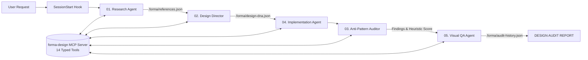

<div align="center">
  
  <h1>Design Forge (FORMA)</h1>
  <p><strong>Beyond Templates. Beyond Generic.</strong></p>
  <p>An intelligent design engineering plugin, MCP server, and visual QA engine for Google Antigravity.</p>

  <p>
    <a href="LICENSE"></a>
    
    
    
    
  </p>

  <p>
    <a href="#architecture">Architecture</a> •
    <a href="#installation">Installation</a> •
    <a href="#mcp-tools-forma-design">MCP Tools</a> •
    <a href="#specialized-agents--skills">Agents &amp; Skills</a> •
    <a href="#quality-scoring-model">Scoring Model</a> •
    <a href="#development--testing">Testing</a>
  </p>
</div>

---

## Overview

**Design Forge (FORMA)** transforms how AI coding agents research, plan, design, implement, and visually verify web applications. Rather than defaulting to generic AI templates, purple-to-blue gradients, pill-and-dot hero clichés, and repetitive three-column grids, FORMA enforces an art-directed engineering pipeline:

1. **Research Before Pixels:** Extracts product positioning and inspects 15–25 industry-specific production references, separating factual DOM/CSS observations from design interpretations.
2. **Project-Specific Design DNA:** Generates WCAG AA-verified palettes, non-Inter typography pairings, spacing/grid tokens, motion principles, and non-generic hero compositions persisted in `.forma/`.
3. **Deterministic Anti-AI Auditing:** Flags generic visual clichés, layout repetition, UI emojis, mixed icon libraries, and excessive radii/shadows with a transparent 100-point observable quality heuristic.
4. **Custom SVG Icon Intelligence:** Audits icon necessity and generates clean, `currentColor`, `viewBox`-standardized SVGs under `src/assets/icons/<category>/`.
5. **Browser-Verified Visual QA:** Validates responsiveness across `1440px`, `1280px`, `1024px`, `768px`, `390px`, and `360px`, compares before/after screenshots, and outputs evidence-backed `DESIGN AUDIT REPORT`s.

---

## Architecture



### Repository Layout

```text
DesignForge/
├── .agents/plugins.json              # Workspace plugin discovery
├── .github/workflows/pages.yml       # GitHub Pages deployment workflow
├── docs/                             # Documentation website (GitHub Pages)
├── LICENSE                           # MIT License (mehefujali)
├── README.md
└── forma/                            # Native Antigravity plugin bundle
    ├── plugin.json                   # Plugin manifest (design-forge)
    ├── mcp_config.json               # Registers forma-design stdio MCP server
    ├── hooks.json                    # SessionStart lifecycle hook
    ├── assets/                       # Plugin logo (logo.png / logo.svg)
    ├── rules/                        # AGENTS.md + 5 modular rulebooks
    ├── skills/                       # 6 progressive-disclosure skills
    ├── agents/                       # 5 specialized agent definitions
    ├── schemas/                      # JSON Schemas (DNA, reference, audit)
    ├── templates/                    # Research, Design Brief & Audit templates
    └── mcp/design-server/            # TypeScript ESM MCP server & test suite
```

---

## Installation

### Option 1: Global Antigravity Install (Recommended)

Clone the repository, build the MCP server, and copy `forma/` into your global Antigravity plugins directory:

```bash
git clone https://github.com/mehefujali/DesignForge.git
cd DesignForge/forma/mcp/design-server
npm install
npm run build
```

Then copy `DesignForge/forma` to:
- **Windows:** `%USERPROFILE%\.gemini\config\plugins\design-forge`
- **macOS / Linux:** `~/.gemini/config/plugins/design-forge`

### Option 2: Workspace-Scoped Discovery

Keep `.agents/plugins.json` at your workspace root pointing to `forma/`. Antigravity automatically discovers `design-forge` when opening the workspace.

### Option 3: Antigravity CLI

```bash
agy plugin install https://github.com/mehefujali/DesignForge.git
```

---

## MCP Tools (`forma-design`)

All 14 tools are implemented in TypeScript with strict `zod` input validation, SSRF/private-IP guards on URL fetching, and path-traversal protection on `.forma/` and `src/assets/icons/` writes.

| Category | Tool | Purpose |
| :--- | :--- | :--- |
| **Research** | `project_analyze` | Extracts strategic brief, flags missing context, and sets industry reference targets |
| **Research** | `research_references` | Generates industry-tailored queries and inspects public URLs with caching |
| **Research** | `inspect_reference` | Parses HTML/CSS into factual observations vs. design interpretations (respects CAPTCHAs) |
| **Research** | `extract_design_patterns` | Synthesizes strong decisions, conventions, and overused patterns to avoid |
| **Design DNA** | `generate_design_dna` | Generates typography, WCAG AA colors, grid, radius, shadow, motion & hero architecture |
| **Design DNA** | `audit_design_tokens` | Audits CSS/token definitions against Design DNA and anti-default rules |
| **Anti-AI** | `analyze_design_repetition` | Detects repeated 3-col grids, centered-only sections, and badge-above-heading clutter |
| **Anti-AI** | `audit_visual_patterns` | Flags generic AI clichés and computes the 100-point observable quality heuristic |
| **Icons** | `audit_icon_usage` | Detects UI emojis, mixed icon libraries, heading icons, and invalid inline SVGs |
| **Icons** | `generate_custom_svg` | Generates clean `currentColor` SVGs into `src/assets/icons/<category>/` |
| **Visual QA** | `validate_responsive_layout` | Validates `1440`, `1280`, `1024`, `768`, `390`, `360`px viewports for overflow & touch targets |
| **Visual QA** | `compare_screenshots` | Compares before/after PNGs for dimension parity and rendered byte differences |
| **Visual QA** | `create_design_report` | Generates `DESIGN AUDIT REPORT` markdown and appends to `.forma/audit-history.json` |
| **Visual QA** | `generate_refinement_tasks` | Converts prioritized findings into verifiable `REFINE-*` tasks |

---

## Specialized Agents & Skills

| Agent (`forma/agents/`) | Primary Deliverable | Paired Skills (`forma/skills/`) |
| :--- | :--- | :--- |
| `research-agent` | Verified `.forma/references.json` & research report | `project-research` |
| `design-director` | `.forma/design-dna.json` & design brief | `design-system` |
| `anti-pattern-auditor` | Severity-ranked findings & heuristic breakdown | `anti-ai-design`, `custom-icons` |
| `implementation-agent` | Semantic, logic-preserving frontend + custom SVGs | `frontend-implementation`, `custom-icons` |
| `visual-qa-agent` | Multi-viewport screenshots & `DESIGN AUDIT REPORT` | `visual-audit` |

---

## Quality Scoring Model

`audit_visual_patterns` computes an internal **100-point observable quality heuristic** (never a claim of human vs. AI authorship):

| Dimension | Weight | Evaluated Signals |
| :--- | :---: | :--- |
| Visual hierarchy | 15% | Primary `<h1>` landmark, critical clutter penalties |
| Typography | 15% | Non-default typeface selection, weight/scale discipline |
| Layout & spacing | 15% | Section count, structural variety, absence of repeated 3-col grids |
| Brand differentiation | 15% | Absence of purple-blue gradients, blobs, and pill-dot hero clichés |
| Visual consistency | 10% | Surface, border, shadow, and glassmorphism discipline |
| Responsive quality | 10% | Viewport meta & 6-breakpoint verification |
| Iconography | 5% | Custom SVG compliance, zero UI emojis or mixed libraries |
| Accessibility | 5% | Semantic `<main>` / `<nav>` landmarks & contrast |
| Interaction quality | 5% | `prefers-reduced-motion` support & purposeful transitions |
| Content presentation | 5% | Heading/badge clutter restraint |

---

## Design Memory (`.forma/`)

Each project maintains isolated design memory under `<projectRoot>/.forma/`:
- `brief.json` — Product positioning, personas, and objectives
- `references.json` — Cached, inspected reference observations
- `design-dna.json` — Approved typography, color, grid, and motion tokens
- `exceptions.json` — Explicitly justified pattern exceptions
- `audit-history.json` — Historical `DESIGN AUDIT REPORT` scores and findings

---

## Development & Testing

```bash
cd forma/mcp/design-server
npm install
npm test
```

Test coverage includes 7 suites (16 tests): manifest validation, SSRF/path-traversal security guards, live local HTTP reference inspection & caching, WCAG contrast math, anti-AI pattern scoring, custom SVG generation, responsive QA validation, and an end-to-end MCP stdio client test verifying all 14 tools.

---

## License

Released under the [MIT License](LICENSE) by **mehefujali**.
